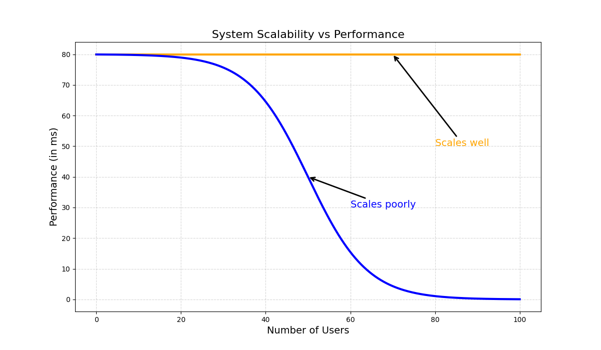

# Latency VS Throughput

Latency and throughput are two important measures of a system’s **performance**.

## Latency
---
Latency refers to the amount of time it takes for a system to respond to a request. It is often measured in **milliseconds** or **microseconds**.

```nginx
Request → Processing → Response
```

**Example**
- API responds in 40 ms
- Database query takes 10 ms
- Network adds 20 ms
- 👉 Total latency ≈ 70 ms

### Latency Impacting factors: 
- **Location** : 
- **Network congestion** : 
- **Protocol efficiency** : Some networks require additional protocols for security. The extra handshake steps create a delay. 
- **Network infrastructure** : 

## Throughput

**Throughput = number of requests processed per unit time in server(Not a number of user trying to access)**

Throughput refers to the **number of requests** a system can handle at the same time. It is often measured in **requests per second**, **transactions per second**, or **bits per second**.

Example: A web server can process 1000 requests per second. That’s its throughput.

## Factors Affecting Throughput
- Available bandwidth
- Packet loss and retransmissions
- Network hardware performance
- Congestion and bottlenecks

---

## Optimization Techniques

### To Reduce Latency:
- Use servers closer to users
- Content Delivery Networks (CDN)
- Efficient routing and caching

### To Improve Throughput:
- Increase bandwidth
- Reduce packet loss
- Optimize network design


